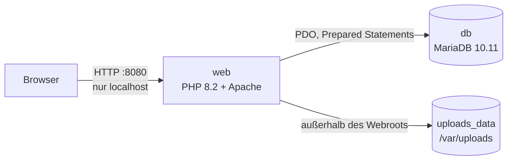
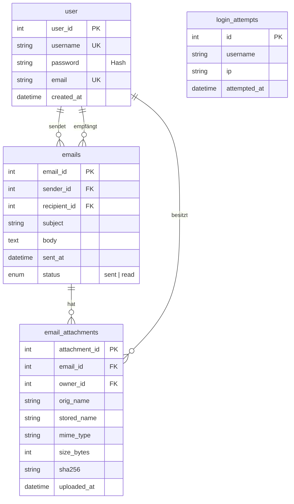

<div align="center">

# SecureMail – Web Security Projekt

**Ein bewusst abgesicherter Web-Mail-Dienst, der im Rahmen einer Web-Security-Übung von anderen Gruppen angegriffen und penetriert wird**


[](https://github.com/if23b152/Web-Vulnerable-Secure/actions/workflows/ci.yml)

</div>

---

Benutzer können sich registrieren, einloggen, E-Mails an andere Benutzer schicken, empfangen und Dateianhänge austauschen. Ziel des Projekts ist es, die Anwendung **so sicher wie möglich** zu bauen – anschließend versucht eine andere Gruppe, sie zu hacken. Die eingesetzten Schutzmaßnahmen sind unten pro Angriffsklasse dokumentiert.

## Inhalt

- [Features](#features)
- [Schnellstart](#schnellstart)
- [Architektur](#architektur)
- [Sicherheitsmaßnahmen](#sicherheitsmaßnahmen)
- [Threat Model](#threat-model)
- [Datenbank](#datenbank)
- [Projektstruktur](#projektstruktur)
- [Hinweise für Tester](#hinweise-für-tester)

## Features

| Bereich | Funktion |
|---|---|
| 👤 Benutzer | Registrieren, Login, Logout |
| 📬 Postfach | Eingang anzeigen, E-Mails mit Betreff und Text verfassen |
| 📎 Anhänge | bis zu 3 Dateien pro E-Mail, je max. 10 MB, nur PDF, PNG, JPEG, TXT |
| ⏱️ Sessions | serverseitige Sessions, automatischer Logout nach 1 Stunde |
| 🔒 Brute-Force-Schutz | nach 5 Fehlversuchen 2 Minuten Sperre (pro Benutzername und IP) |

## Schnellstart

**Voraussetzung:** Docker Desktop

```bash
# 1. Konfiguration anlegen und Passwörter anpassen
cp .env.example .env

# 2. Container bauen und starten (im Projekt-Root)
docker compose up -d --build
```

Danach im Browser **http://localhost:8080** öffnen. Am einfachsten zwei Benutzer registrieren, mit dem einen eine E-Mail an den anderen schicken und sich dann mit dem zweiten einloggen.

```bash
docker compose logs -f web    # Logs ansehen
docker compose down           # stoppen
docker compose down -v        # stoppen und Datenbank + Uploads löschen
```

## Architektur



| Container | Aufgabe |
|---|---|
| `web` | UI, Session-Handling, Authentifizierung, Datei-Upload und -Download |
| `db` | Tabellen `user`, `emails`, `email_attachments`, `login_attempts` – nicht nach außen veröffentlicht |
| `uploads_data` | Volume für Anhänge, nicht direkt über den Webserver erreichbar |

## Sicherheitsmaßnahmen

| Angriffsklasse | Schutz |
|---|---|
| **SQL Injection** | ausschließlich PDO Prepared Statements, DB-Fehler werden nicht an den Client ausgegeben |
| **XSS** | konsequentes `htmlspecialchars()` bei jeder Ausgabe (auch Benutzername/E-Mail), strikte **Content-Security-Policy** (`script-src 'self'`, kein Inline-JS) |
| **CSRF** | CSRF-Token auf Login, Registrierung, Logout und E-Mail-Versand – Pflicht, nicht optional; Cookies mit `SameSite=Strict` |
| **Broken Authentication** | `password_hash()` / `password_verify()`, automatisches Rehashing, Session-ID-Regeneration nach Login, Strict Session Mode, konstante Laufzeit auch bei unbekannten Benutzern (keine User-Enumeration über Timing) |
| **Brute Force** | Fehlversuche in der Datenbank pro Benutzername **und** IP gezählt (nicht in der Session umgehbar); kein öffentlicher Reset-Endpoint |
| **Broken Access Control** | Downloads nur eingeloggt und nur für Sender/Empfänger; fremde Anhänge liefern dieselbe Antwort wie nicht existierende |
| **Unsichere Uploads** | MIME-Prüfung per `finfo` **und** Abgleich mit der Dateiendung, Größen- und Anzahl-Limit, bereinigte Dateinamen, zufällige Speichernamen, SHA-256, Speicherung außerhalb des Webroots, `.htaccess` mit `Require all denied` und PHP-Engine aus |
| **Unsichere Downloads** | sichere `Content-Disposition` (UTF-8-Dateiname), `X-Content-Type-Options: nosniff`, restriktive CSP mit Sandbox (außer für PDF-Vorschau) |
| **Clickjacking & Header** | `X-Frame-Options: DENY`, `frame-ancestors 'none'`, `Referrer-Policy`, `Permissions-Policy` |
| **Information Disclosure** | `ServerTokens Prod`, `ServerSignature Off`, `expose_php = Off`, `display_errors = Off`, kein Directory Listing, `.env`/`.git`/`.ht*` gesperrt |
| **Server-Härtung** | gefährliche PHP-Funktionen deaktiviert (`exec`, `system`, `shell_exec`, …), `allow_url_fopen/include = Off`, `TRACE` aus |
| **Secrets** | Zugangsdaten nur in `.env` (nicht im Repository), Web-Port nur auf `127.0.0.1` gebunden |

Konfiguration: [`php.ini`](php.ini) · [`Dockerfile`](Dockerfile) · [`src/cookies.php`](src/cookies.php) (Header, Session, CSRF)

## Threat Model

| Schützenswert | Bedrohung | Gegenmaßnahme |
|---|---|---|
| Zugangsdaten | Diebstahl, Brute Force, Credential Stuffing | Hashing, Rate-Limit, Session-Härtung |
| Nachrichten | Mitlesen fremder Mails, XSS-Wurm im Postfach | Zugriffsprüfung pro Benutzer, Output-Escaping, CSP |
| Anhänge | Upload von Webshells, Zugriff auf fremde Dateien | Typprüfung, Speicherung außerhalb des Webroots, Download nur über Berechtigungsprüfung |
| Datenbank | SQL Injection, direkter Zugriff | Prepared Statements, DB-Port nicht veröffentlicht |

## Datenbank



Schema: [`database/init.sql`](database/init.sql)

## Projektstruktur

```text
├── Dockerfile               PHP 8.2 + Apache, gehärtete Apache-Konfiguration
├── docker-compose.yml       web + db + Volumes
├── php.ini                  gehärtete PHP-Einstellungen
├── .env.example             Vorlage für Zugangsdaten
├── database/init.sql        Datenbankschema
├── src/
│   ├── index.php            Startseite / Posteingang
│   ├── login.php, signUp.php, logout.php
│   ├── compose.php          E-Mail verfassen
│   ├── send_email.php       Versand inkl. Upload-Prüfung
│   ├── emails.php           Posteingang mit Anhängen
│   ├── download_attachment.php  geschützter Download
│   ├── cookies.php          Security-Header, Session, CSRF
│   └── db_queries/          Datenbankzugriffe (Login, Registrierung, Abfragen)
└── Dokumentation_WebSec.pdf Projektdokumentation mit Screenshots
```

## Hinweise für Tester

- Die Anwendung startet mit leerer Datenbank – bitte selbst Benutzer registrieren.
- Die Gruppe, die das Projekt testet, darf den gesamten Quellcode verwenden (White-Box-Test).
- Gefundene Schwachstellen bitte mit Schritten zur Reproduktion dokumentieren.

Viel Spaß beim Hacken! 🛡️
